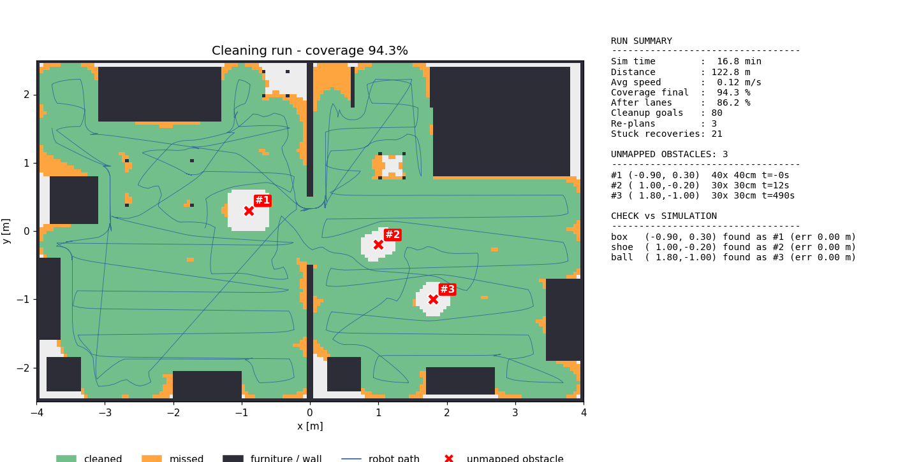

# TidyBot-Sim: Autonomous Cleaning Robot with SLAM and Coverage Planning

A two-room house cleaning-robot simulation built on **ROS 2 Humble** and **Gazebo Classic 11**.
A round vacuum-style robot (Ø 34 cm) maps the house with **slam_toolbox**, plans a lawn-mower
coverage path with an occupancy-grid planner, drives under low furniture, detects obstacles that are
not in its prior map, and writes a final cleaning report.


https://github.com/user-attachments/assets/87a4fef9-dabc-4c32-b2ff-01ea7ba6757c




## Results (one full run)

| Metric | Value |
|---|---|
| Final coverage | **94.3 %** (86.2 % after lane sweep, rest from cleanup pass) |
| Simulated time | 16.8 min |
| Distance driven | 122.8 m |
| Unmapped obstacles found | **3 / 3** (box, shoe, ball), matched within the 5 cm grid resolution |
| Stuck recoveries | 21 |
| Re-plans | 3 |

The same planner reached 94.5 % with the SDF robot and 94.3 % with the Xacro robot, so the model format does not change behaviour.

## Features

- **Two-room house world** generated by a script (`scripts/generate_world.py`): doorway, sofa, armchair, coffee table, desk, bed, wardrobe, shelves, plants.
- **Open-leg furniture**: the robot is only 11.5 cm tall, so it cleans under the coffee table and the desk.
- **SLAM** with slam_toolbox (online async) using a 360° lidar.
- **Coverage planner** (`scripts/coverage_planner.py`):
  - 5 cm occupancy grid built from furniture footprints, inflated by the robot radius
  - flood-fill reachability, lawn-mower lanes, nearest-neighbour ordering of segments
  - A* with no corner cutting, line-of-sight smoothing, pure-pursuit tracking
  - cleanup pass for missed cells, stuck detection and recovery, re-planning when a path is blocked
- **Unmapped-obstacle detection**: lidar hits not explained by the prior map are clustered and logged.
- **Final report** (`report.png`, `report.md`, `report.json`): coverage map, path, run statistics, obstacle list.
- **Two robot descriptions**: `models/ugv.sdf` (plain SDF) and `urdf/ugv.urdf.xacro` (Xacro with macros, `robot_state_publisher`, RobotModel in RViz).

## Requirements

- Ubuntu 22.04 (or WSL2), ROS 2 Humble
- `ros-humble-gazebo-ros-pkgs`, `ros-humble-slam-toolbox`, `ros-humble-xacro`, `ros-humble-robot-state-publisher`, `ros-humble-rviz2`
- Python: `numpy`, `matplotlib`

## Build

```bash
mkdir -p ~/ugv_ws/src && cd ~/ugv_ws/src
git clone https://github.com/aa-masum/tidybot-sim-ros2.git ugv_sim
cd ~/ugv_ws
colcon build --packages-select ugv_sim
source install/setup.bash
```

## Run

Use one terminal per step (source the workspace in each).

```bash
# 1. Simulation (Xacro/URDF robot)
ros2 launch ugv_sim sim_urdf.launch.py
# or the SDF robot:
# ros2 launch ugv_sim sim.launch.py

# 2. SLAM
ros2 launch slam_toolbox online_async_launch.py \
  slam_params_file:=$HOME/ugv_ws/src/ugv_sim/config/slam.yaml use_sim_time:=true

# 3. RViz (WSL2: software rendering)
LIBGL_ALWAYS_SOFTWARE=1 rviz2 --ros-args -p use_sim_time:=true

# 4. Coverage planner
ros2 run ugv_sim coverage_planner.py --ros-args -p use_sim_time:=true
```

In RViz set Fixed Frame to `map` and add: Map (`/map`), Map (`/coverage_map`), Path (`/coverage_path`),
LaserScan (`/scan`), MarkerArray (`/found_obstacles`), RobotModel (Description Topic `/robot_description`, Xacro launch only).

Do not run `obstacle_avoider.py` together with the planner. Both publish on `/cmd_vel`.

When the run finishes the planner prints `DONE` and saves the report to `~/ugv_reports/run_*/`.

## Topics

| Topic | Type | Purpose |
|---|---|---|
| `/scan`, `/scan_low` | LaserScan | 360° lidar, low front sensor |
| `/odom`, `/cmd_vel` | Odometry, Twist | differential drive |
| `/coverage_percent` | Float | cleaned area in % |
| `/coverage_map` | OccupancyGrid | visited cells |
| `/coverage_path` | Path | planned route |
| `/found_obstacles` | MarkerArray | unmapped obstacles |

## Project structure

```
ugv_sim/
├── config/slam.yaml
├── launch/sim.launch.py          # SDF robot
├── launch/sim_urdf.launch.py     # Xacro robot + robot_state_publisher
├── models/ugv.sdf
├── urdf/ugv.urdf.xacro
├── worlds/house.sdf              # generated
├── scripts/generate_world.py
├── scripts/coverage_planner.py
└── scripts/obstacle_avoider.py   # simple reactive baseline
```

## Limitations

- The planner uses a prior footprint map of the furniture. SLAM runs alongside it, but planning does not depend on the SLAM map.
- The ground-truth check of found obstacles works only in simulation.
- Odometry is ideal Gazebo odometry, with no wheel slip or sensor noise tuned.
- 21 stuck recoveries in the reported run. Narrow gaps near furniture are the main cause.
- Average speed is 0.12 m/s, chosen for safety, so a run takes about 17 minutes.

## Future work

Frontier exploration without a prior map, battery and docking behaviour, a time-weighted heatmap of cleaned cells, noise in odometry and lidar, Nav2 integration.

## License

MIT
